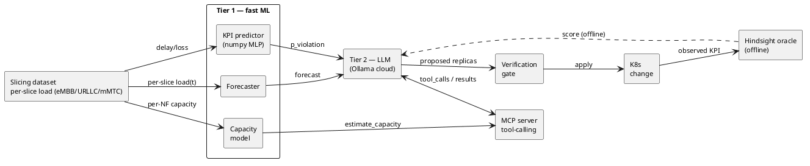

# Two-Tier Control Plane for 6G Slicing

Fast ML (Tier 1) + LLM/MCP compiler (Tier 2). Turns ML signals + KPIs + cluster state into verified per-slice Kubernetes changes. Prototype is built and tested end to end.

## Architecture



Source: `docs/architecture.puml`.

## Loop

1. Load a sample: per-slice offered load (eMBB / URLLC / mMTC) + global delay/loss.
2. Tier 1 (fast ML): forecaster + numpy MLP predict delay and violation probability.
3. Analytic capacity model converts per-slice load -> required replicas.
4. Payload = per-slice KPIs + ML signals + current replicas -> Tier 2 LLM.
5. LLM proposes per-slice replica counts (MCP typed tool, or YAML manifest).
6. Verification gate checks schema + policy, then applies.
7. Hindsight oracle (offline, greedy P95) scores the decision vs future load.

## Dataset

| Dataset | Gives | Backing paper |
|---------|-------|---------------|
| Network slicing dataset | per-slice load -> delay/jitter/loss (10k sims, WFQ) | Farreras et al. 2024, Zenodo 10610616 |

One dataset only. AdapShare (temporal load) and DeepSlice (slice classifier) optional, excluded. OpenRAN too large.

## Results (ramp, 100 states, per-slice closed loop)

```
method                  viol%  repl  under  over   mae
threshold                24.7  2.50   1.11  0.11  0.49
hpa                      15.7  2.63   0.95  0.08  0.00
predict-then-threshold   15.7  2.63   0.95  0.08  0.00
capacity-rule            1.0  3.73   0.16  0.38  1.10
llm-real-flash            7.7  3.93   0.53  0.96  1.48
```

- Real LLM beats threshold and HPA on violation, at higher replica cost.
- capacity-rule shares the oracle's capacity model (`required_replicas`), so it is a
  near-optimal upper-bound reference, not a competitor to beat. Intentionally
  close to the solution — it shows the ceiling the model allows.

## LLM models (Ollama cloud, localhost, no token)

| Model | mean latency | notes |
|-------|-------------|-------|
| glm-5.3-flash:cloud | 4.4 s | fast; ran the full 100-step loop |
| deepseek-v4-pro:cloud | 7.1 s | |
| glm-5.3:cloud | 8.4 s | |
| mistral-large-4:cloud | 22.7 s | ~2x tokens, same decisions |

## Repo layout

```
src/            # prototype (env, capacity, oracle, gate, mcp_server, llm, benchmark, experiment, report)
tests/          # pytest, 8 passing
results/        # experiment_results.json + graphs
initial_results.pdf
PLAN.md         # full plan + findings (section 15)
timeline.md     # pipeline steps
```

## Commands

```
python -m pytest tests -q
python -m src.experiment          # benchmarks + 4-model LLM calls -> results JSON
python -m src.run_real_full       # real LLM over full 100-step ramp
python -m src.report              # build initial_results.pdf
python -m src.mcp_server          # serve MCP over stdio
```

## Status

End to end done. RQ5 answered: `estimate_capacity` tool cuts MAE 1.18->0.20 and cost 3.47->2.55 but raises violation 6.7%->11.7% (exact, not safer). Centerpiece (Mode T / Mode D / YAML-vs-MCP) still open — see `initial_results.pdf` and PLAN.md §15.
